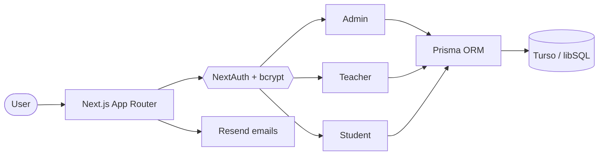

<div align="center">


**I build web apps that solve real problems, and I'm getting better at DSA every day.**

<a href="https://ashishportfolioss.netlify.app/"></a>
<a href="https://leetcode.com/u/mrashish10x/"></a>
<a href="https://www.hackerrank.com/profile/ashishkumar28321"></a>


</div>

---

## 👋 Quick intro

```text
$ whoami
ashish — B.Tech IT student, Rajkiya Engineering College, Bijnor

$ cat now.txt
→ shipping a multi-role SaaS (Presently) with Next.js + Prisma
→ solving DSA problems in C++
→ learning how production apps are actually secured & deployed

$ cat goal.txt
→ land a software engineering internship, then a full-time role
```

---

## 🚀 Flagship project: Presently

> **A multi-role attendance management SaaS** for colleges, with separate Admin, Teacher and Student areas.

<table>
<tr>
<td width="55%" valign="top">

**What it does**

- 🔐 Role-based login: `/login/admin`, `/login/teacher`, `/login/student`
- 🏫 College-aware data model (multiple colleges, isolated data)
- 🧑‍🏫 Teacher assignment boundaries & attendance workflow
- ✉️ Email integration via Resend, Google OAuth sign-in
- 📊 Dashboards and charts with Recharts

**Status:** 🟡 active development

[](https://presentylive.netlify.app/login/admin)
[](https://github.com/mrashish10x/presently)

</td>
<td width="45%" valign="top">

**Built with**


-4FF8D2?style=flat-square&logo=turso&logoColor=black)


</td>
</tr>
</table>

**How the pieces fit together**



---

## 🧰 Tech I work with

<div align="center">

| | |
|---|---|
| **Languages** |      |
| **Frontend** |      |
| **Backend & Data** |    |
| **Tools** |     |

</div>

---

## 🌐 Other work

| Project | What it is | Links |
|---|---|---|
| **Personal Portfolio** | My personal site: skills, projects and journey in one place | [Live](https://ashishportfolioss.netlify.app/) · [Code](https://github.com/mrashish10x/portfolio) |

---

## 📈 Activity

<div align="center">


</div>

---

## 🤝 Let's connect

I'm open to **internships, open-source contributions and project collaborations**.
The best way to reach me is through my [portfolio](https://ashishportfolioss.netlify.app/) or by opening an issue / following on GitHub.

<div align="center">

<sub>⭐ If something here helped or interested you, a star on my repos means a lot.</sub>

</div>
